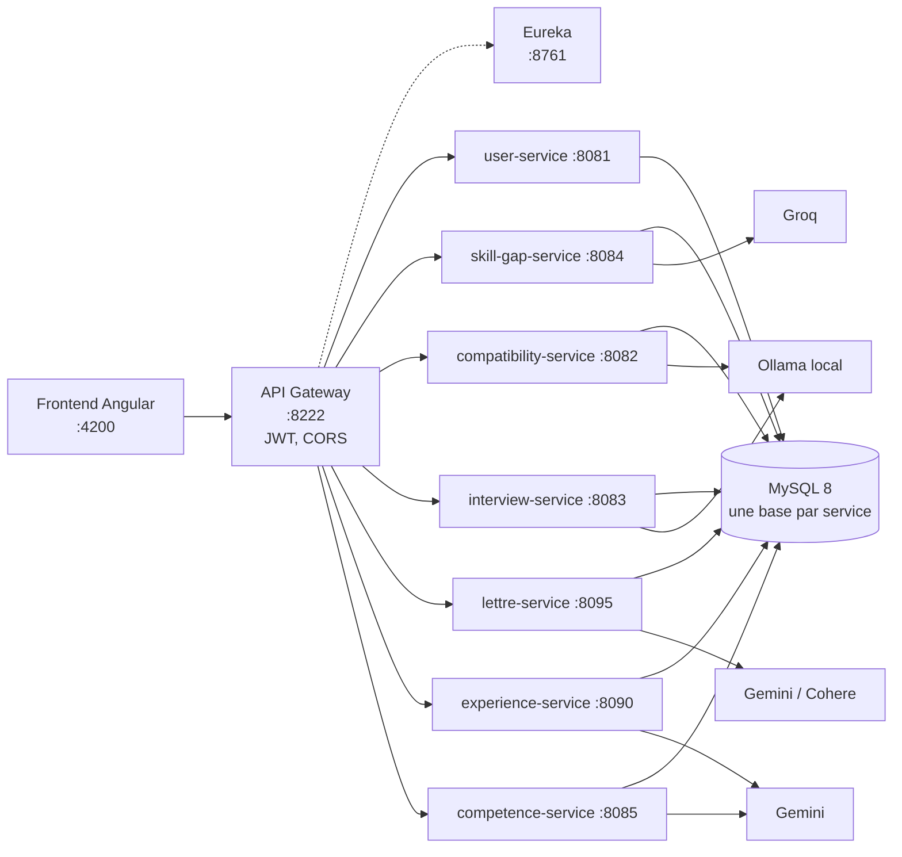

# CareerAI

Plateforme web d'aide à l'emploi en **microservices**, enrichie par l'IA : gestion des comptes, analyse d'écart de
compétences entre un CV et une offre, score de matching, préparation d'entretien, lettres de motivation, pitch
d'entretien et conseiller d'orientation.

Mini-projet **IA for Software Engineering** · ESPRIT · année universitaire 2026 – 2027.

## Équipe et modules

| Module | Réalisé par | Rôle | IA utilisée |
|---|---|---|---|
| `user-service` | Ameni Guesmi | Comptes, rôles, JWT, e-mails de vérification | — |
| `skill-gap-service` | Ameni Guesmi | Compétences à améliorer pour une offre | Groq `openai/gpt-oss-120b` + RAG lexical (135 fiches) |
| `compatibility-service` | Farah Chbeb | Score de compatibilité CV / offre | Ollama `qwen2.5:7b` (agent avec outil) |
| `interview-service` | Fawzi Saidi | Questions d'entretien et feedback | Ollama `qwen3.5:4b` + `bge-m3` (RAG hybride) |
| `lettre-service` | Farah Amami | Génération et amélioration de lettres de motivation | Google Gemini ou Cohere |
| `experience-service` | Marah Mhadhbi | Expériences et pitch « Présentez-vous » | Google Gemini 3.5 Flash-Lite (prompts enchaînés + juge) |
| `competence-service` | Yesmine Chakroun | Formations, compétences, conseiller d'orientation | Google Gemini 3.1 Flash-Lite (conseiller + juge) |

Aucun modèle n'est entraîné : chaque module utilise un modèle existant, adapté par le prompt, le RAG, la
validation de la sortie, le cache ou un second appel « juge ». Règles communes : **aucune donnée personnelle brute
envoyée au LLM** (e-mails, téléphones, liens masqués), **sortie validée avant affichage**, **erreurs d'appel
gérées** (timeout, quota, clé absente).

## Architecture



Le frontend ne parle qu'à la gateway. Elle vérifie le JWT émis par `user-service` et route chaque requête vers le
service trouvé dans Eureka. Chaque service vérifie aussi le jeton : l'identité de l'utilisateur vient toujours du
jeton, jamais de la requête.

| Service | Port | Route de la gateway | Base MySQL |
|---|---|---|---|
| `eureka-server` | 8761 | — | — |
| `api-gateway` | 8222 | point d'entrée unique | — |
| `user-service` | 8081 | `/api/users/**` | `careerai_users` |
| `compatibility-service` | 8082 | `/api/compatibility/**` | `compatibility_db` |
| `interview-service` | 8083 | `/api/interview/**` | `interview_db` |
| `skill-gap-service` | 8084 | `/api/skill-gap/**` | `careerai_skillgap` |
| `competence-service` | 8085 | `/api/formations/**`, `/api/competences/**`, `/api/orientation/**` | `careerai_competences` |
| `experience-service` | 8090 | `/api/experiences/**`, `/api/pitch/**` | `careerai_experiences` |
| `lettre-service` | 8095 | `/api/lettres/**` | `careerai_lettre` |
| `frontend` | 4200 | — | — |

## Technologies

| Couche | Technologie |
|---|---|
| Front-end | Angular 21 (composants standalone, signals), TypeScript 5.9, Bootstrap 5.3, ng-bootstrap 19 |
| Back-end | Java 17, Spring Boot 3.2 (3.3 pour `lettre-service`), Spring Data JPA, Spring Security + JWT (jjwt) |
| Microservices | Spring Cloud Gateway et Eureka (Spring Cloud 2023.0) |
| Données | MySQL 8 ; Flyway pour `interview-service` |
| Documents | PDFBox, Apache POI (extraction du texte des CV) |
| IA | API Groq et Cohere (compatibles OpenAI), API Gemini, Ollama en local ; Lucene BM25 pour le RAG d'`interview-service` |
| Tests | JUnit 5, Mockito, MockMvc, H2, faux serveurs HTTP ; Jasmine et Karma pour le frontend |
| Déploiement | Docker Compose (13 conteneurs) |

## Configuration

Les secrets ne sont **jamais** dans le code : ils sont lus dans des variables d'environnement ou dans un fichier
`.env` à la racine, ignoré par Git.

```powershell
Copy-Item .env.example .env   # puis remplir les valeurs
```

| Variable | Obligatoire | Utilisée par |
|---|---|---|
| `JWT_SECRET` | oui | tous les services (secret Base64 identique partout, 32 octets minimum) |
| `LLM_API_KEY` | oui | `skill-gap-service` (clé Groq : https://console.groq.com/keys) |
| `GEMINI_API_KEY` | oui avec Docker | `lettre-service`, `experience-service`, `competence-service` (Google AI Studio) |
| `MAIL_USERNAME`, `MAIL_PASSWORD` | oui | `user-service` (Gmail et mot de passe d'application de 16 caractères) |
| `ADMIN_EMAIL`, `ADMIN_PASSWORD` | oui | `user-service` (administrateur créé au premier démarrage) |
| `COHERE_API_KEY` | non | `lettre-service` (second fournisseur) |
| `LLM_MODEL`, `LLM_REASONING_EFFORT` | non | `skill-gap-service` (`openai/gpt-oss-120b`, `low`) |
| `OLLAMA_MODEL` | non | `compatibility-service` (`qwen2.5:7b`) |
| `DB_USER`, `DB_PASSWORD` | non | services Spring (`root`, vide) |
| `EUREKA_USER`, `EUREKA_PASSWORD` | non | services Spring (`admin`, `admin123`) |

Ne commitez jamais `.env`, ni une clé ou un mot de passe dans un fichier `application.properties` ou
`application.yml` : le dépôt est public.

## Lancement avec Docker Compose

Prérequis : Docker Desktop, environ 9 Go d'espace pour les modèles Ollama.

```powershell
docker compose up -d --build   # premier démarrage : builds + téléchargement des modèles Ollama
docker compose ps              # tous les services "running", ollama-pull en "exited (0)"
```

Application : http://localhost:4200 · Eureka : http://localhost:8761 · Gateway : http://localhost:8222.
MySQL est publié sur le port **3307** côté PC, car le 3306 est souvent pris par XAMPP.

Le module d'entretien demande une indexation de sa base de connaissances, une seule fois, avec le compte
administrateur :

```powershell
. .\scripts\dev-env.ps1
.\scripts\rag-reindex.ps1 -Email $env:ADMIN_EMAIL -Password $env:ADMIN_PASSWORD
```

## Lancement en local (sans Docker)

Prérequis : JDK 17 ou plus, Maven 3.9, Node.js et Yarn, MySQL (XAMPP sur le port 3306), Ollama pour
`compatibility-service` et `interview-service` (`.\scripts\ollama-pull.ps1` télécharge les modèles d'entretien,
`ollama pull qwen2.5:7b` celui du matching).

1. Démarrer MySQL : les bases sont créées automatiquement.
2. Charger les variables du `.env` dans le terminal : `. .\scripts\dev-env.ps1`.
3. Démarrer dans cet ordre, chacun avec `mvn spring-boot:run` dans son dossier (ou depuis IntelliJ) :
   `eureka-server`, puis `api-gateway`, puis `user-service`, puis les autres services.
4. Démarrer le frontend : `cd frontend`, `yarn install`, puis `yarn start` → http://localhost:4200.

## Tests

Chaque service a ses tests, qui s'exécutent **sans MySQL et sans appel réel à un LLM** : la base est simulée ou en
mémoire (H2), et les fournisseurs d'IA sont remplacés par de faux serveurs locaux.

```powershell
cd skill-gap-service ; mvn test        # même commande dans chaque dossier de service
                                       # (lettre-service : dossier lettre-service/lettre-service)
cd frontend ; yarn test --watch=false --browsers=ChromeHeadless
```

| Module | Tests |
|---|---|
| `user-service` | 48 |
| `skill-gap-service` | 91 (+ `ModelComparisonTest`, désactivé par défaut) |
| `compatibility-service` | 147 (+ `ModelEvaluationTest`, désactivé par défaut) |
| `interview-service` | 28 (+ 43 vérifications de bout en bout avec `scripts/smoke-test.ps1`) |
| `lettre-service` | 84 |
| `experience-service` | 128 |
| `competence-service` | 83 |
| `frontend` | 86 |

Comparaison réelle des modèles de `skill-gap-service` (appelle l'API Groq, consomme du quota) :

```powershell
cd skill-gap-service
mvn test -Dtest=ModelComparisonTest -Dcompare.models=openai/gpt-oss-120b,openai/gpt-oss-20b -Dcompare.runs=2
# résultat : target/model-comparison.md
```

Évaluation chiffrée et comparaison des modèles de `compatibility-service` (Ollama local, 6 cas annotés) :

```powershell
cd compatibility-service
.\mvnw clean test -Dtest=ModelEvaluationTest -Deval.models=qwen2.5:7b,qwen2.5:3b -Deval.runs=2
# résultat : target/evaluation/model-comparison.md
```

## Structure du dépôt

```
CareerAI/
├── api-gateway/            Spring Cloud Gateway (routes, CORS, vérification du JWT)
├── eureka-server/          annuaire des services
├── user-service/           comptes et JWT
├── skill-gap-service/      analyse d'écart de compétences (LLM + RAG)
├── compatibility-service/  score de matching (agent Ollama)
├── interview-service/      préparation d'entretien (RAG hybride)
├── lettre-service/         lettres de motivation (projet Maven dans lettre-service/lettre-service)
├── experience-service/     expériences et pitch d'entretien
├── competence-service/     formations, compétences, orientation
├── frontend/               application Angular
├── knowledge/              base de connaissances du module d'entretien (Markdown)
├── docker/mysql/init/      création des bases au premier démarrage de MySQL
├── scripts/                scripts PowerShell (variables, modèles Ollama, indexation, test de bout en bout)
├── docker-compose.yml
└── .env.example            modèle de configuration (sans valeur)
```

| Script | Rôle |
|---|---|
| `scripts/dev-env.ps1` | Charge les variables du `.env` dans la session PowerShell |
| `scripts/fill-env-from-root.ps1` | Complète les clés vides du `.env` (n'affiche aucune valeur) |
| `scripts/ollama-pull.ps1` | Télécharge les modèles Ollama du module d'entretien |
| `scripts/rag-reindex.ps1` | Réindexe la base de connaissances du module d'entretien (compte ADMIN) |
| `scripts/smoke-test.ps1` | Test de bout en bout du module d'entretien à travers la gateway |

Des README détaillés existent pour [`skill-gap-service`](skill-gap-service/README.md),
[`compatibility-service`](compatibility-service/README.md) et [`interview-service`](interview-service/README.md).
